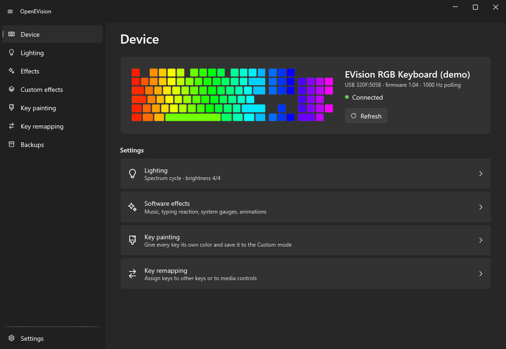
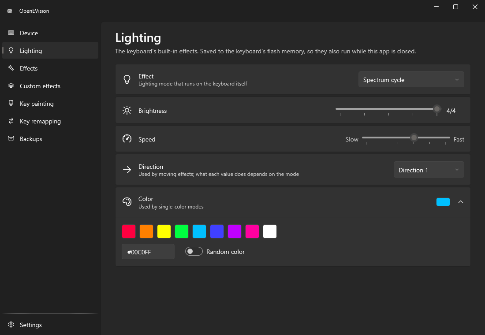
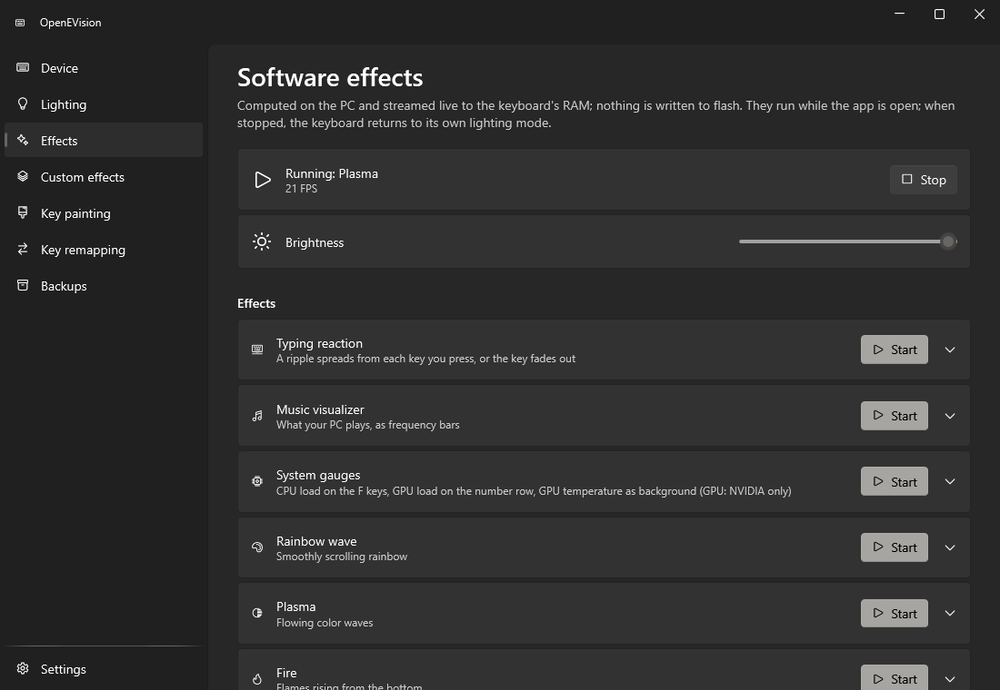
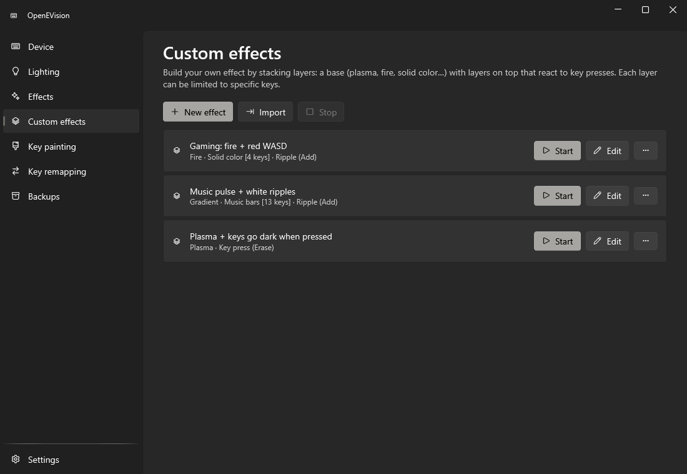
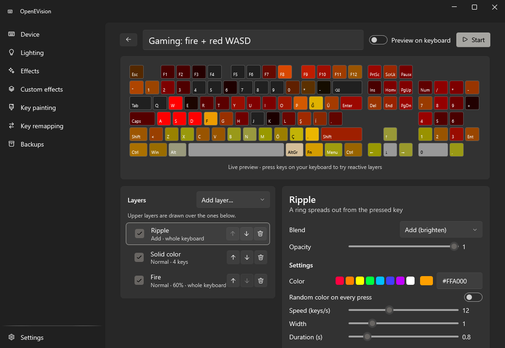
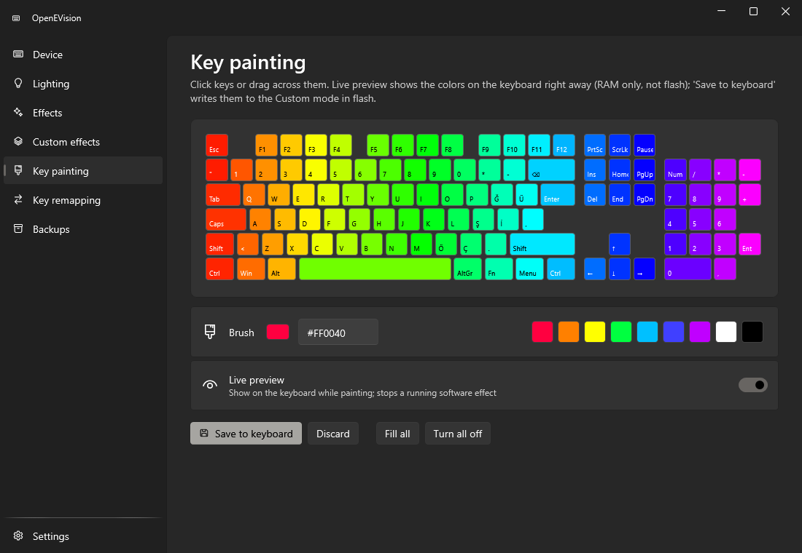
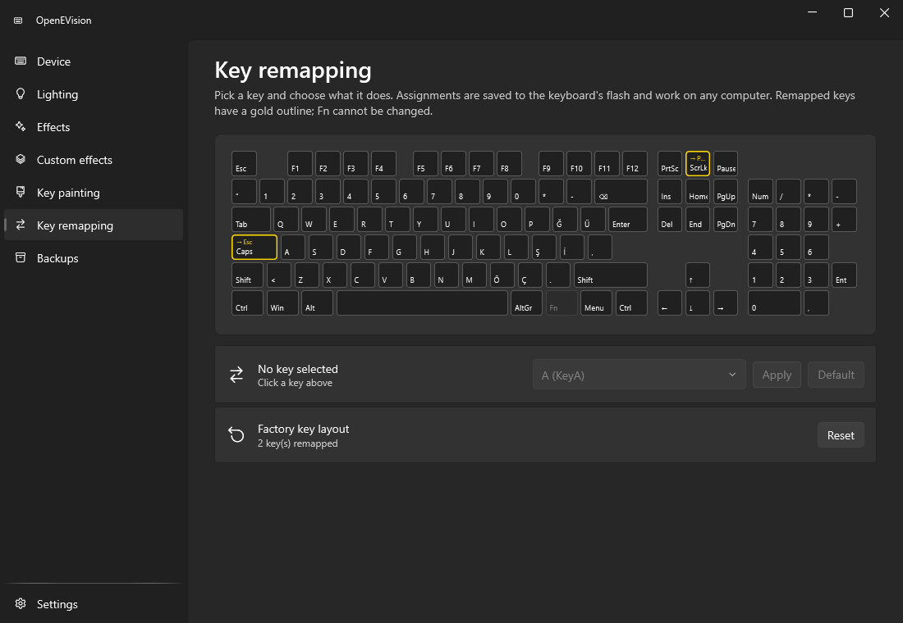
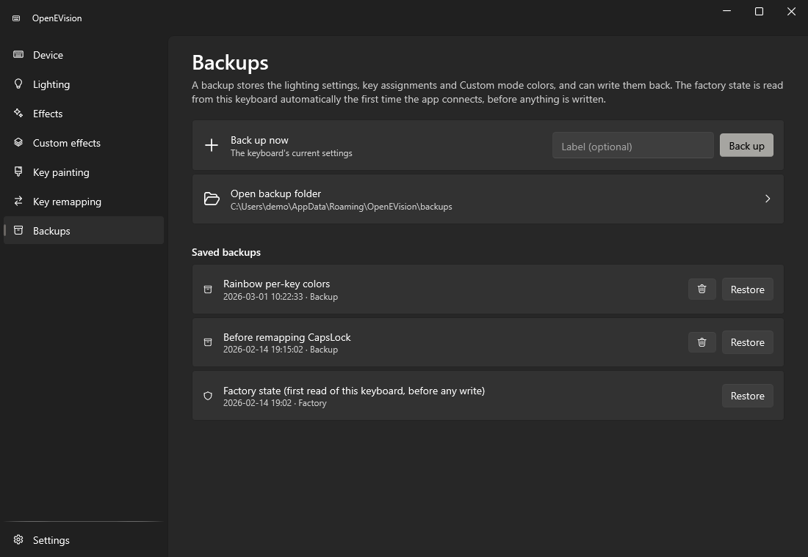
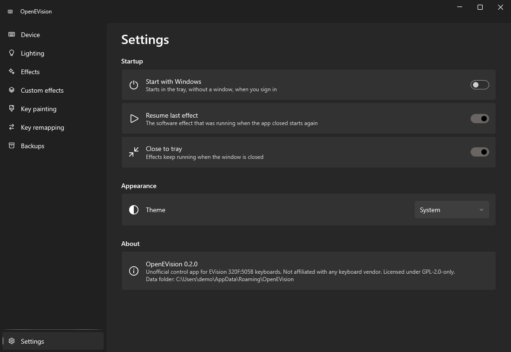

# OpenEVision

Unofficial Windows app for RGB keyboards with an EVision controller: hardware lighting modes, per-key colors, key
remapping, backups, and live software effects (music visualizer, typing reactions, system gauges, layered custom effects).

> [!WARNING]
> **OpenEVision writes to your keyboard's flash memory** (lighting mode, per-key colors, key assignments). It is not
> made or endorsed by the keyboard's manufacturer, and it talks to the keyboard through an undocumented protocol.
> Before it writes anything, it saves a copy of your keyboard's original settings, and every write is limited to known
> regions. Even so, a wrong write could leave the keyboard misconfigured or, in the worst case, unusable.
> **Use it at your own risk.**

## Screenshots

| | |
|---|---|
|  |  |
|  |  |
|  |  |
|  |  |
|  | |

## Supported hardware

OpenEVision supports **EVision-controller keyboards reporting USB `320F:505B`**.
Tested layout: **full-size ISO / Turkish-Q, 126 LEDs**.

To check your keyboard: open Device Manager, find the keyboard under *Human Interface Devices* or *Keyboards*, open
*Properties → Details → Hardware Ids*, and look for `VID_320F&PID_505B`. Keyboards with other ids are not opened.
A keyboard with the same id but a different layout (ANSI, other ISO variants, TKL) may work for lighting modes and
backups, but the on-screen keyboard and per-key LED positions will not match.

If no supported keyboard is connected, the Device page says so and nothing is sent anywhere.

## Features

- **Lighting**: the keyboard's built-in modes (wave, breathing, static, reactive, starlight, …) with brightness, speed,
  direction, color and random color. Saved to the keyboard, so they keep running without the app.
- **Key painting**: give every key its own color with a live preview, then save it to the keyboard's Custom mode.
- **Key remapping**: assign any key (except Fn) to another key, a modifier, a media key, or disable it. Remaps are
  stored on the keyboard and work on any computer. Single-key default and full factory reset.
- **Backups**: save and restore lighting settings, key assignments and Custom colors. A factory backup of *your*
  keyboard is taken automatically on first connection, before anything is written.
- **Software effects** (streamed to the keyboard's RAM, never to flash): typing reaction, music visualizer
  (whatever your PC plays), CPU/GPU gauges, rainbow, plasma, fire, matrix rain.
- **Custom effects**: stack layers (solid, gradient, breathing, stars, rainbow, plasma, fire, matrix, music bars,
  key press, ripple, hold) with blend modes, opacity, per-layer key masks and audio/CPU/GPU modulation. Import and
  export as JSON. Three examples are created on first run.
- Tray icon, single instance, optional start with Windows (starts minimized to the tray), resumes the last effect.
- Light, dark or system theme (Windows 11 Fluent style).

## Requirements

- Windows 10 or 11, x64.
- A supported keyboard (see above).
- GPU gauges need an NVIDIA GPU with `nvidia-smi` on the PATH (installed with the NVIDIA driver).
- The release exe is self-contained: no .NET installation needed.

## Install

1. Download `OpenEVision.exe` from the [latest release](../../releases/latest)
   (or the zip, which also contains this README and the license). `SHA256SUMS.txt` lists the checksums.
2. Put it anywhere you like and run it. There is no installer; the exe is not code-signed, so Windows SmartScreen may
   ask you to confirm the first start (*More info → Run anyway*).

To uninstall: turn off *Start with Windows* in Settings (or delete the `OpenEVision` value under
`HKCU\Software\Microsoft\Windows\CurrentVersion\Run`), delete the exe, and delete `%APPDATA%\OpenEVision` if you no
longer want your backups and effects.

## Usage

1. **Connect.** Start the app with the keyboard plugged in. The *Device* page shows the product name, USB id, firmware
   version, polling rate and the keyboard's current Custom colors. On this first connection the app reads the whole
   configuration and saves it as the factory backup.
2. **Make a backup** on the *Backups* page before experimenting (optional, the factory backup already exists).
3. **Lighting**: pick a mode and adjust it. Changes are written to the keyboard shortly after you stop moving a control.
4. **Key painting**: click or drag over keys with a brush color. With *Live preview* on, the colors show right away
   without touching flash; *Save to keyboard* writes them and switches the keyboard to the Custom mode.
5. **Key remapping**: click a key, choose an action, *Apply*. Remapped keys get a gold outline and a caption.
   *Default* restores one key, *Reset* restores all of them from the factory backup.
6. **Effects / Custom effects**: press *Start*. Effects run while the app runs (also from the tray when the window is
   closed). *Stop* hands the keyboard back to its hardware mode. In the editor, every change is saved automatically and
   previewed on screen; turn on *Preview on keyboard* to see it live on the keyboard.
7. **Restore**: on the *Backups* page, *Restore* writes a backup's lighting header, key table and Custom colors back.

## Limitations and known issues

- Only USB `320F:505B` is opened, and only one layout (full-size ISO / Turkish-Q) is drawn and mapped.
- Fn cannot be remapped and is invisible to the typing effects (it never reaches the PC).
- The meaning of the *Direction* values depends on the hardware mode and is not documented; they are labelled
  Direction 1–4.
- GPU load and temperature come from `nvidia-smi` only; on AMD or Intel GPUs those gauges stay empty.
- Software effects stop while the PC sleeps or the app is closed; the keyboard then shows its hardware mode.
- Running another RGB program at the same time can make the lights flicker or fight over the keyboard.
- The music visualizer listens to the default playback device only.

## Troubleshooting

- **"No supported keyboard found"**: check the Hardware Ids (see *Supported hardware*), try another USB port, and close
  other RGB software that may hold the keyboard's vendor interface.
- **"The keyboard is busy"**: another OpenEVision process is talking to the keyboard; close it (check the tray).
- **Effect shows "Cannot send to the keyboard"**: the keyboard was unplugged; it reconnects on its own when plugged back in.
- **Lighting change does not show**: a software effect draws over hardware modes; stop it on the *Effects* page
  (changing a mode on the *Lighting* page stops it automatically).
- **Keys light up in the wrong place**: your keyboard's layout differs from the tested one; see *Supported hardware*.
- **Something went wrong after a write**: open *Backups* and restore the *Factory state* entry.

## Privacy and security

- **Nothing leaves your computer.** The app makes no network connections, has no telemetry and no update check.
- **Stored data** (all in `%APPDATA%\OpenEVision`): `settings.json` (app settings, effect parameters, last effect),
  `backups\` (your backups as JSON), `effects\` (custom effects as JSON), and the factory backup
  (`factory-config.bin`, `factory-custom.bin`, `factory-info.json` with the USB id, product name and firmware version).
- **Registry**: only the `OpenEVision` value under `HKCU\...\Run`, and only while *Start with Windows* is on.
- **Keyboard hook**: typing and reactive effects install a system-wide low-level keyboard hook while they run. It only
  uses which physical key went down or up to light it; keystrokes are not stored, logged or sent anywhere. The hook is
  removed when the effect stops.
- **Audio**: the music effects capture the default playback device (WASAPI loopback) and only compute frequency levels
  in memory; nothing is recorded or saved.
- **nvidia-smi** is started locally every 2 seconds while a GPU gauge is in use.
- **Writes to the keyboard** are restricted by a write guard to the lighting header, the key table and the color
  tables; see [docs/PROTOCOL.md](docs/PROTOCOL.md).

## Build from source

Requirements: Windows, [.NET 10 SDK](https://dotnet.microsoft.com/download).

```bat
rem build and start (Release)
app.bat

rem one self-contained single-file exe in dist\
publish.bat

rem or directly
dotnet build app/OpenEVision.csproj -c Release
dotnet test tests/OpenEVision.Tests/OpenEVision.Tests.csproj
dotnet publish app/OpenEVision.csproj -c Release -o dist
```

`tools/make-icon.py` (Python 3, standard library only) regenerates `app/Resources/app.ico`.

### Development

- Project layout: `app/Device` (protocol, device profile, storage, backups), `app/Effects` (software and custom
  effects), `app/Pages` (UI), `app/Dev` (Debug-only developer tools), `tests/` (xUnit tests, run against the Debug
  build and a simulated keyboard).
- Adding a keyboard model: add a `DeviceProfile` in `app/Device/DeviceProfile.cs` (USB ids, LED matrix, key table
  geometry, layout file in `app/Resources`) and select it in `DeviceProfiles.Active`.
- Debug builds accept developer switches (they are not compiled into Release builds):
  - `--demo`: run the normal UI against a simulated keyboard and a throwaway data folder in `%TEMP%`.
  - `--snapshot DIR [--theme light|dark]`: render every page in demo mode to `DIR\*.png` (the README screenshots), then exit.
  - `--probe FILE`: read-only check of a real keyboard (info, mode, config, colors, write guard); only reads from the keyboard.
  - `--effect-test FILE`: run every effect briefly on a real keyboard (RAM only).
  - `--write-test FILE`: **writes to a real keyboard's flash**: remaps ScrollLock, rewrites the colors, then restores a backup and compares.

  Example: `app\bin\Debug\net10.0-windows\OpenEVision.exe --snapshot docs\screenshots`
- CI (`.github/workflows/ci.yml`) builds, tests and publishes on every push to `main` and on pull requests. Pushing a tag `v*`
  (for example `v0.2.0`) runs `.github/workflows/release.yml`, which publishes the exe with that version and creates a
  GitHub Release with the exe, a zip and SHA-256 checksums. No secrets are needed beyond the built-in `GITHUB_TOKEN`.

## Disclaimer

OpenEVision is an independent project. It is not affiliated with, endorsed by or supported by EVision, any keyboard
brand or vendor, NVIDIA or Microsoft; all names are used only to describe compatibility. It writes to your keyboard's
flash memory using a reverse-engineered protocol. The software is provided without any warranty; you use it at your
own risk.

## License and credits

OpenEVision is licensed under the **GNU General Public License v2.0 only** (GPL-2.0-only); see [LICENSE](LICENSE) for the
license text and [NOTICE](NOTICE) for the copyright notice (Copyright (c) 2026 iefedev).

- [OpenRGB](https://gitlab.com/CalcProgrammer1/OpenRGB) (GPL-2.0-only): the EVision command set and the default
  21-column LED matrix are derived from OpenRGB's EVision keyboard controller.
- [WPF-UI](https://github.com/lepoco/wpfui) (MIT): Fluent controls and theming.
- [NAudio](https://github.com/naudio/NAudio) (MIT): WASAPI loopback capture and FFT.
- Tests use [xUnit](https://xunit.net) (Apache-2.0).
